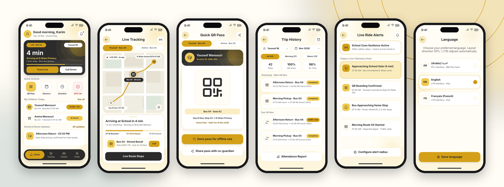
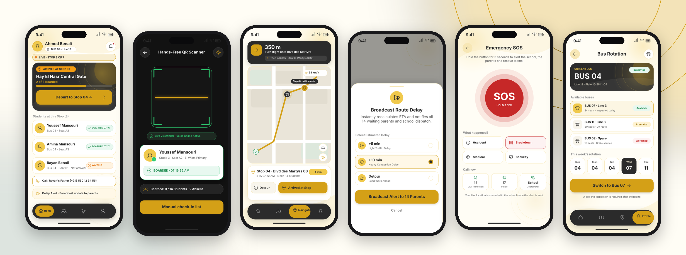
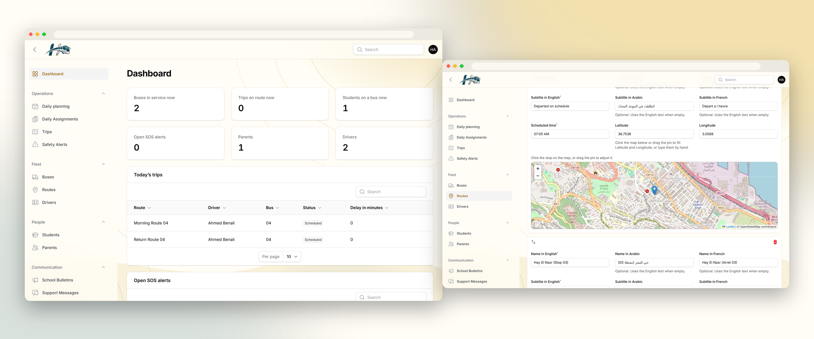
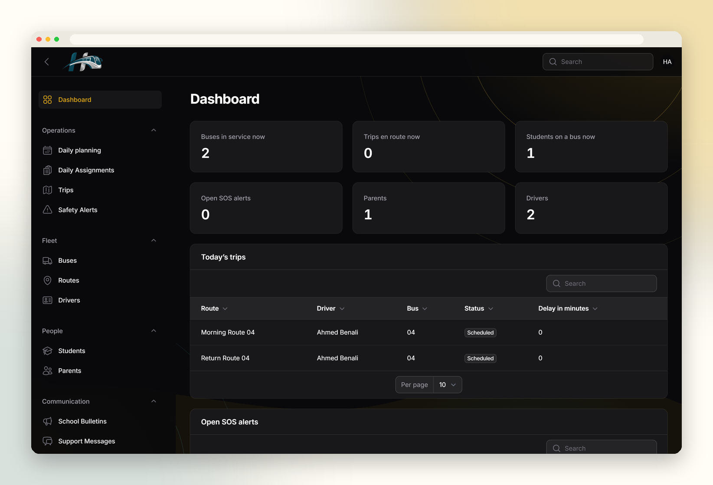
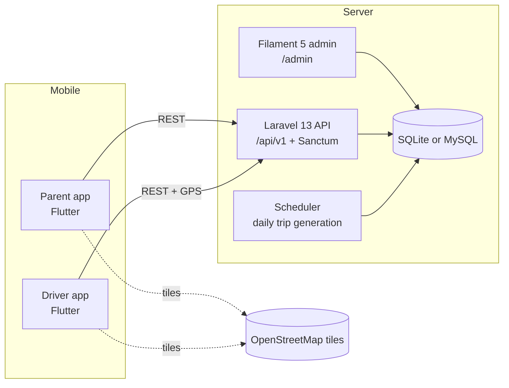
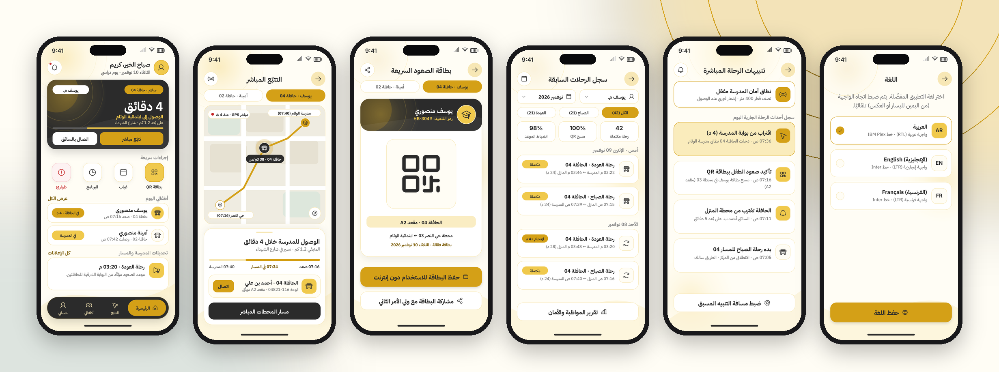
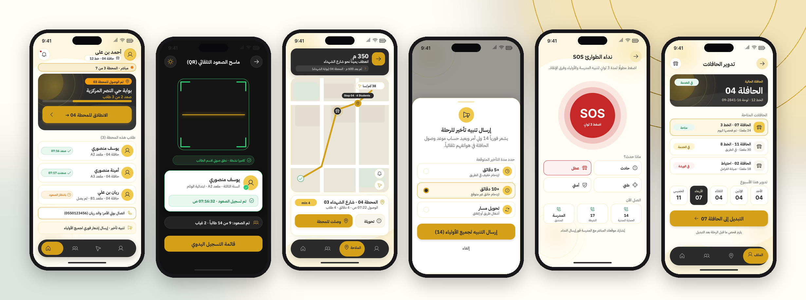

<div align="center">


# Hanna Bus (هنّا باص)

**School transport, end to end: a parent app, a driver app and an admin dashboard on one API.**
Safe school trips, live tracking, QR boarding.




</div>

## What it is

Hanna Bus connects three people around one school bus.

| Who | Gets | Where |
|---|---|---|
| **Parents** | Live bus position on a free OpenStreetMap map, a QR boarding pass per child, delay alerts, trip history, messages with the driver | `hanna_bus_parent/` (Flutter) |
| **Drivers** | Daily mission control, QR boarding scanner, turn by turn map, one tap delay broadcast, SOS, parent messages, daily bus rotation | `hanna_bus_driver/` (Flutter) |
| **School staff** | Fleet, routes with a map picker for stops, students and parents, daily planning, safety alerts, bulletins, support inbox | `backend/` (Laravel + Filament) |

<div align="center">

</div>

### Admin dashboard

<div align="center">

</div>

Filament 5 back office with grouped navigation, light and dark themes, English and Arabic (RTL), and a map picker for route stops (click the map or drag the pin). The dark theme:

<div align="center">

</div>

## Highlights

- **One versioned API** (`/api/v1`) with role based access (parent, driver, admin) enforced by middleware and policies, Sanctum tokens and login throttling. The contract lives in [`docs/driver-api-contract.md`](docs/driver-api-contract.md).
- **Real time tracking without paid map services:** OpenStreetMap tiles via `flutter_map`, driver GPS posted to the API, parents poll the live position.
- **QR boarding:** every student has a unique code; the driver scans it, the parent sees the event.
- **Daily operations model:** routes and stops are templates; each day's trips are generated from them (`php artisan hanna:generate-trips`), driver to bus assignments can be carried over from the last service day.
- **Privacy by design:** drivers receive a minimised child object, only the fields needed to run a trip, and every role sees only its own data.
- **Three languages and RTL:** the parent app ships English, Arabic (right to left) and French; the driver app English and Arabic; the dashboard English and Arabic.
- **Designed first:** the whole UI was drawn in [FigCraft](AGENTS.md) (parent: 6 pages, 36 screens; driver: 7 pages, 41 screens, EN and AR) before it was built. Exports and the build scripts are in [`design/`](design) and [`scripts/`](scripts).
- **Tested:** 190 backend tests (PHPUnit), plus widget and unit tests in both Flutter apps (overflow, RTL, contrast and locale persistence included).

## Architecture



## Repository layout

```
backend/            Laravel API and Filament admin (tests in backend/tests)
hanna_bus_parent/   Parent Flutter app (EN, AR, FR)
hanna_bus_driver/   Driver Flutter app (EN, AR)
design/             Palettes, brand assets, icons used by the design scripts
scripts/  lib/      Python scripts that draw the screens in FigCraft
output/             Saved FigCraft documents and design exports
docs/               API contract and README images
```

## Getting started

### Backend and admin

Requirements: PHP 8.3+, Composer. SQLite is the default database.

```bash
cd backend
composer install
cp .env.example .env
php artisan key:generate
php artisan migrate --seed      # demo data, local and testing environments only
php artisan serve
```

- API: `http://127.0.0.1:8000/api/v1`
- Admin dashboard: `http://127.0.0.1:8000/admin` (demo admin created by the local seeder, see [`backend/ADMIN.md`](backend/ADMIN.md))

Run the tests with `php artisan test`. Format with `vendor/bin/pint`.

### Mobile apps

Requirements: Flutter 3 (Dart 3.12+). The API address is passed at build time.

```bash
cd hanna_bus_parent        # or hanna_bus_driver
flutter pub get
flutter run --dart-define=HANNA_API_URL=http://127.0.0.1:8000/api/v1
flutter analyze && flutter test
```

On the Android emulator use `http://10.0.2.2:8000/api/v1`. Release builds are signed from an untracked `android/key.properties` and fall back to the debug key when it is absent:

```bash
flutter build apk --release --split-per-abi --target-platform android-arm64 \
  --dart-define=HANNA_API_URL=https://your-server/api/v1
```

### Daily trips

Trips for a day are created from active routes:

```bash
php artisan hanna:generate-trips --date=2026-11-24 --carry-assignments
```

It is scheduled for 00:05 daily; run `php artisan schedule:run` from cron on your server.

## Tech stack

| Layer | Tools |
|---|---|
| API | PHP, Laravel 13, Sanctum, PHPUnit, Pint |
| Admin | Filament 5, Livewire 4, Leaflet (stop picker) |
| Apps | Flutter, flutter_map, geolocator, mobile_scanner, shared_preferences |
| Design | FigCraft, Phosphor icons, IBM Plex Sans Arabic and Inter |

## Design system

Mustard palette (`#D4A017`, `#F0C94C`, `#F7E7B5`, `#FFFDF5`, charcoal `#2B2B2B`) with a teal accent from the logo. Light and dark modes, shared motion tokens, and RTL handled by mirroring the layout rather than flipping assets.

---

<div dir="rtl" align="right">

## بالعربية

**هنّا باص** منظومة نقل مدرسي متكاملة: تطبيق للأولياء، وتطبيق للسائقين، ولوحة تحكم للإدارة، على واجهة برمجية واحدة.

- **الأولياء:** تتبّع الحافلة مباشرة على خريطة مجانية، وتذكرة صعود برمز QR لكل تلميذ، وتنبيهات التأخير، وسجل الرحلات، ورسائل مع السائق.
- **السائقون:** لوحة الرحلة اليومية، ومسح رمز QR للصعود، وخريطة الملاحة، وإعلان التأخير بنقرة، وزر الاستغاثة SOS.
- **الإدارة:** الحافلات والمسارات (مع اختيار موقع المحطة من الخريطة) والتلاميذ والأولياء والتخطيط اليومي وتنبيهات السلامة والإعلانات.
- **اللغات:** العربية (من اليمين إلى اليسار) والإنجليزية والفرنسية في تطبيق الأولياء، والعربية والإنجليزية في تطبيق السائق ولوحة التحكم.




</div>
