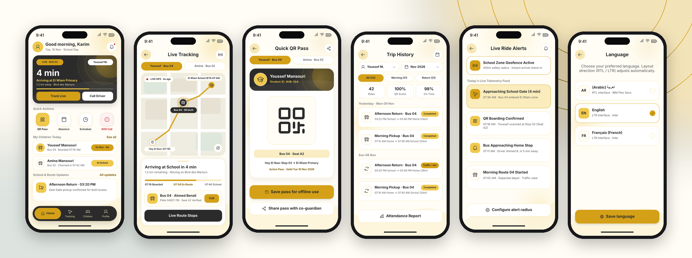

# Hanna Bus Parent

The parent app of [Hanna Bus](../README.md): live bus tracking, QR boarding pass, delay alerts, trip history and messages with the driver. English, Arabic (RTL) and French, three palettes, light and dark mode.



## Run

```bash
flutter pub get
flutter run --dart-define=HANNA_API_URL=http://127.0.0.1:8000/api/v1
flutter analyze && flutter test
```

Use `http://10.0.2.2:8000/api/v1` on the Android emulator. Android application ID: `com.hannabus.hanna_bus_parent`.

## Release build

```bash
flutter build apk --release --split-per-abi --target-platform android-arm64 \
  --dart-define=HANNA_API_URL=https://your-server/api/v1
```

Signing is read from an untracked `android/key.properties` (`storeFile`, `storePassword`, `keyAlias`, `keyPassword`); without it the build uses the debug key.
